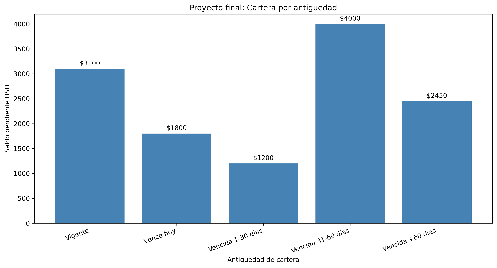
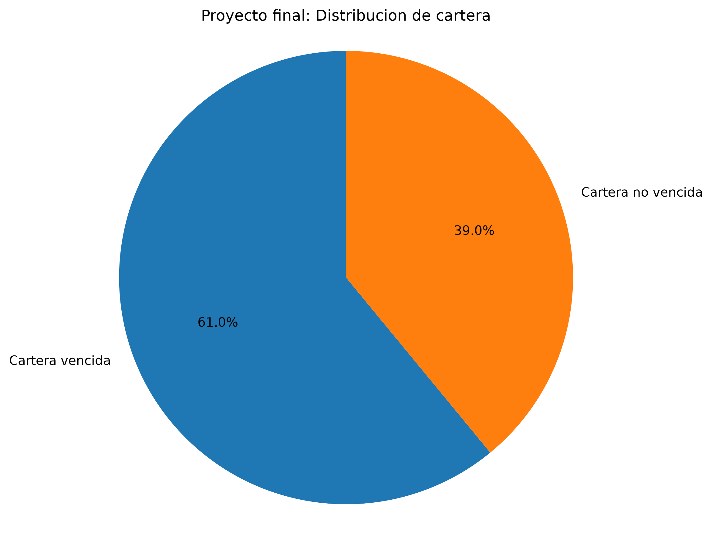

# Análisis de Cuentas por Cobrar con Python

## Descripción del proyecto

Proyecto de análisis financiero desarrollado con Python
para evaluar una cartera de cuentas por cobrar, identificar
facturas vencidas y proponer estrategias de recuperación.

Se utilizan datos de práctica de ocho facturas, con fecha
de corte del 13 de noviembre de 2026.

## Objetivos

- Calcular los días de atraso de cada factura.
- Clasificar la cartera por rangos de antigüedad.
- Identificar los saldos vencidos.
- Calcular indicadores financieros (KPIs).
- Visualizar los resultados mediante gráficos.
- Formular recomendaciones de cobranza.

## Herramientas utilizadas

- **Python:** procesamiento y automatización.
- **Pandas:** limpieza, clasificación y agrupación.
- **Matplotlib:** gráficos financieros.
- **VS Code:** desarrollo y ejecución.

## Principales resultados

| Indicador | Resultado |
|---|---:|
| Cartera total | $12.550 |
| Cartera vencida | $7.650 |
| Cartera no vencida | $4.900 |
| Porcentaje vencido | 60,96% |
| Facturas vencidas | 5 |
| Cartera mayor a 60 días | $2.450 |

El rango de 31 a 60 días concentra el mayor saldo
vencido, con $4.000.

## Visualizaciones

### Cartera por antigüedad



### Distribución de cartera



## Recomendaciones financieras

1. Priorizar la recuperación de las facturas vencidas.
2. Contactar a los clientes con atrasos superiores a 60 días.
3. Negociar compromisos de pago y dar seguimiento.
4. Implementar recordatorios preventivos.
5. Monitorear semanalmente los indicadores financieros.

## Cómo ejecutar el proyecto

1. Tener Python instalado en la computadora.

2. Abrir una terminal dentro de la carpeta del proyecto.

3. Instalar las bibliotecas necesarias:

   ```bash
   python -m pip install pandas matplotlib
   ```

4. Ejecutar el programa:

   ```bash
   python analisis_cuentas_por_cobrar.py
   ```

5. Cerrar las ventanas de los gráficos para que el programa
   continúe hasta mostrar el informe ejecutivo.

6. Revisar los dos gráficos PNG generados en la carpeta
   `Gráficos`.

## Conclusión

El proyecto demuestra cómo Python permite transformar
datos de cuentas por cobrar en información útil para
la toma de decisiones financieras.

**Proyecto académico desarrollado para un portafolio
de Data Analytics.**